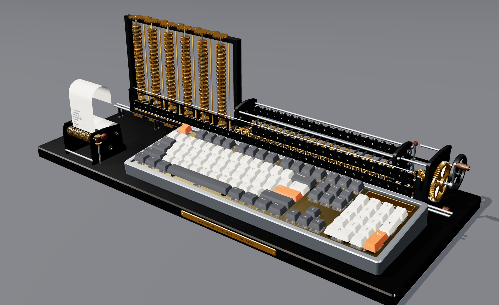

# Mechanical Calculator

An Unreal Engine 5 visualization of a full-size mechanical keyboard that is also a calculator for
the math in [Where It Isn't](https://github.com/jcorky/where-it-isnt). Every part of the keyboard is
built procedurally at runtime: the case, plate, PCB, switches with their springs and contact leaves,
the stabilizers, and the sculpted keycaps. Type on your own keyboard (or click the keys) and the
virtual one presses each key with simulated switch dynamics, clicks with synthesized sound, and
shows the result on its OLED.

The calculator understands a small matrix language and **@FUNCTIONS@ functions on @CATEGORIES@ library
pages** ported from Where It Isn't's chapters and benches: Möbius maps and Riccati equations, LQR,
Kalman and MPC, the equation sheet and flight model, radar and lens antennas, orbits and inertial
navigation, logistics, graphs and SLAM, groups, Hilbert spaces, measure, optimization, lattices and
GNSS, category theory, procedural systems and expansion fields. **@CASES@ reference cases** check
them against Where It Isn't's own JavaScript modules, or against independent numpy computations
where a chapter has no module.



## Running it

You need Unreal Engine 5.4 or later with a C++ toolchain (Visual Studio 2022, Xcode or clang).

1. Right-click `MechanicalCalculator.uproject` and choose *Generate Visual Studio project files*
   (or run `GenerateProjectFiles` for your platform), then build the `MechanicalCalculatorEditor`
   target. You can also open the `.uproject` and let the editor compile it.
2. Open the project and press **Play**. The project ships no maps or assets: the game mode adds the
   keyboard, a desk, lights and a camera to any level that lacks them, starting from the engine's
   empty `Entry` map.
3. The keyboard types a short demo on its own. Your first keystroke takes over.

Packaged builds need the master materials as assets. Run `mc.SaveMaterials` once in the editor
console, which saves them to `/Game/MechanicalCalculator/Materials`. In the editor they are
built in memory.

| Control | |
|---|---|
| Type | the virtual keyboard follows your keyboard |
| Left click | presses a key (modifiers stay down until the next key) |
| Right drag | orbits the camera; the middle button pans, the wheel zooms, a thumb button resets |
| Enter | evaluates the line |
| Tab | completes a function name |
| F1 | help for the function at the cursor |
| F2 / F3 | DEG–RAD, display digits |
| F4 or Menu | the library browser: arrows to move, Enter to insert |
| F5–F12 | `sqrt(`, `^2`, `ln(`, `exp(`, `sin(`, `cos(`, `tan(`, `pi` |
| Up / Down | history; PgUp / PgDn scroll the tape |
| Pause | exploded view of the build |
| ScrLk | backlight: off, static, wave, breathe, reactive, roles |
| Shift + numpad | `\` `.*` `'` `,` `;` for matrix entry |
| Num Lock off | the numpad navigates |

In the editor, Esc ends Play-in-Editor before the keyboard sees it (on the board it clears the line).
Shift+F1 frees the mouse.

## The calculator

```
> h = hohmann(6678e3, 42164e3)        records print every field
= dv1 = 2425.769028
  dv2 = 1466.838715
  ...
> h.dv1 + h.dv2                       fields and 1-based indexing: h(1)
= 3892.607744
> db(snr_track(1.4e6, 2000, 0.1, 1, 111e3, 950, 1.67e6, 6.3))
= 1.294026112                         the Lincoln lecture's airport radar, as printed
> A = [1, 0.1; 0, 1]; B = [0.005; 0.1]
> P = dare(A, B, eye(2), 0.5)         matrices: ',' columns, ';' rows
> rho(A - B * dlqr(A, B, eye(2), 0.5))
```

- **Operators:** `+ - * / ^`, element-wise `.* ./ .^`, transpose `'`, left division `A \ b`
  (least squares when A is not square), and factorial `!`.
- **Syntax:** `x = ...` assigns, `;` separates statements, and `ans` holds the last value.
- **Constants:** `pi`, `e`, `g0`, `c0`, `kB`, `T0`, `mu_earth`, `R_earth`, `gamma_air`, `cp_air`, `R_air`, `ft`, `nmi`,
  `kt`, `km`, `hr`, `day`, `inf`, `nan`.
- **Commands:** `help <fn>`, `list`, `list <page>`, `vars`, `clear`, `deg`, `rad`, `digits <n>`.

Units are SI, and angles are radians except in the elementary trig functions, which follow the
DEG/RAD key. Every function, its arguments and units, and where it lives in Where It Isn't are
listed in **[Docs/FUNCTIONS.md](Docs/FUNCTIONS.md)**, generated from the registry.

The calculator also runs without Unreal:

```sh
cmake -S Tests -B build && cmake --build build -j
./build/mcalc_cli                 # a REPL with the same engine
./build/mcalc_tests               # every test and reference case
```

## How it is built

```
Source/MechanicalCalculator/
  Calc/       the calculator: expression language, linear algebra (LU, QR/SVD, Jacobi, Francis QR,
              Pade expm, DARE by doubling, CARE by the matrix sign function, Lyapunov) and one
              library file per part of Where It Isn't
  Geometry/   procedural meshes: keycaps, switches, stabilizers, plate, PCB, case (OLED optional),
              and the gear mechanism: stepped drums, carriage, memory columns, printer, plinth
  Keyboard/   the firmware (input line, history, completion, tape, library browser), switch
              dynamics, synthesized key sounds, RGB backlight, and the 104-key ANSI layout
  Public/, Private/   the Unreal layer: AMechanicalKeyboard, the viewer pawn, the studio set,
              the game mode, runtime materials and procedural audio
Tests/        native CMake build of Calc, Geometry and Keyboard with the tests, the reference
              cases and their generators, the CLI, and the preview renderer
```

Everything under `Calc/`, `Geometry/` and `Keyboard/` is plain C++17, written to Unreal's rules: no
exceptions, no RTTI, and unity-build-safe names. The native build compiles it with
`-Wall -Wextra -Wshadow -Werror -fno-exceptions -fno-rtti`, with a force-included header that
defines the macros Unreal and Windows define (`PI`, `check`, `IN`, `near`, `ERROR`, …). It also
compiles the files as one translation unit, the way Unreal Build Tool does. The Unreal layer is
thin: it converts the meshes to `UProceduralMeshComponent` sections, steps one switch model per
key, and forwards keystrokes to the firmware.

### Verification

| What | How |
|---|---|
| The library | @CASES@ reference cases in `Tests/reference/*.tsv`. Each case is an expression typed exactly as on the keyboard, with its expected value, generated by `Tests/reference/gen_*` from Where It Isn't's own modules (`orbits.js`, `radar.js`, `equations.js`, `logistics.js`, …) or from numpy ports of its verification scripts. `regenerate.sh` rebuilds them; CI regenerates them from a fresh checkout and fails on any difference. |
| Properties | per-library tests, for example: Lambert's solution flown by the integrator lands on r2, the CW matrix equals `expm` of Hill's equations, LLL meets its bound, Sinkhorn's marginals hold, and no strategy beats the game's par. |
| Linear algebra | eigenvalues of similarity-transformed triangular matrices, SVD reconstruction, `expm` closed forms, DARE against 5000 Riccati iterations, the CARE residual and its closed form, and Lyapunov residuals |
| Geometry | every part closed and outward-facing, with positive volume by the divergence theorem and the right Euler characteristic; every switch inside its plate cut-out |
| Keyboard | typing through the physical layout (shift, caps, numpad matrix entry), editing, history, completion, the screen layout, switch timing against the spec, and the sounds |

**Not verified here:** the Unreal layer (`Public/`, `Private/`) has been checked against stub
headers for syntax and types, but it has not been compiled against the engine or run, because
this repository was built where Unreal is unavailable. Expect a first build to need small API
fixes for your engine version. `bFlipWinding` on the keyboard actor reverses every triangle if
your version renders the meshes inside out.

## Licence

MIT. See [LICENSE](LICENSE).
