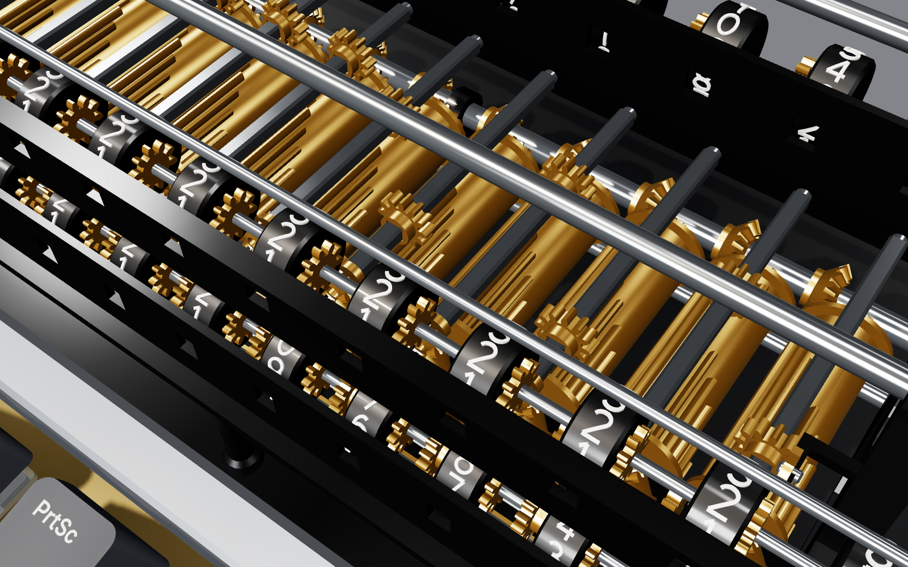
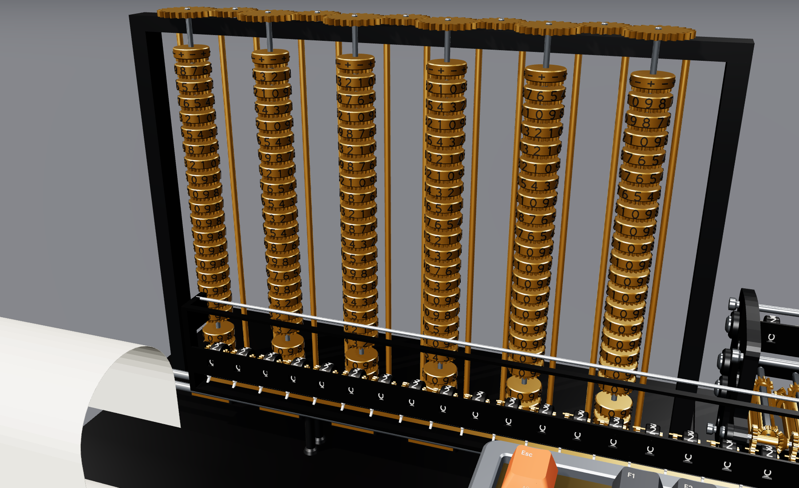
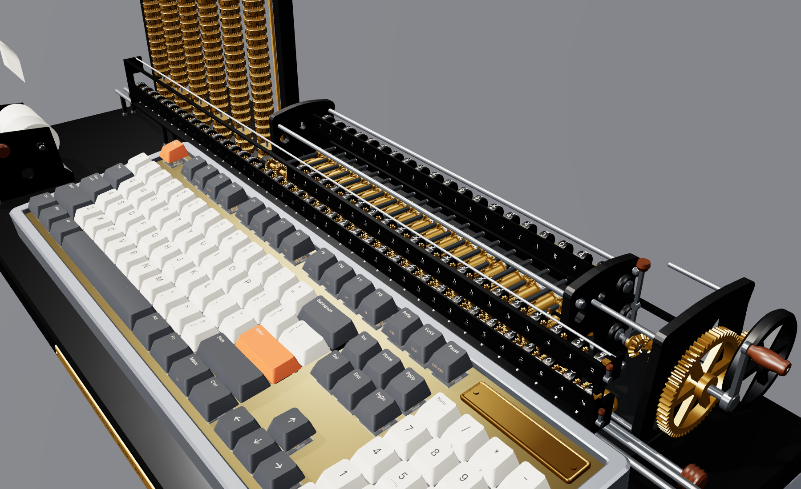
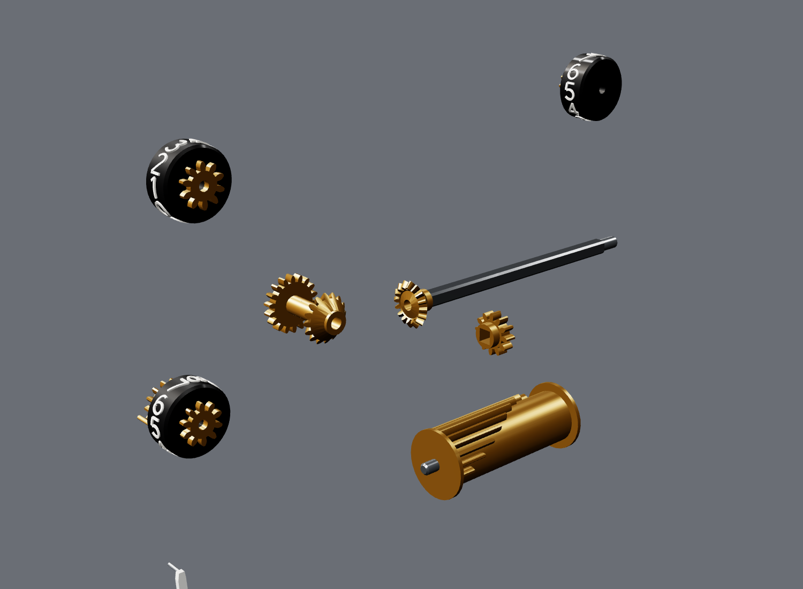

# Mechanical Calculator

An Unreal Engine 5 visualization of a gear-driven calculating machine that does the math in
[Where It Isn't](https://github.com/jcorky/where-it-isnt). You type on a full-size mechanical
keyboard. Behind it, a stepped-drum mechanism in the line of Leibniz's Stepped Reckoner and the
Thomas arithmometer does every calculation:

- brass stepped drums with pinions that slide along square shafts;
- a sliding carriage with black numeral wheels behind slotted window bars;
- white tens-carry levers;
- a crank with a turned wooden handle, a spoked drive gear and a flywheel;
- a reversing lever and an overdraft bell.

A type-wheel printer prints the tape. Columns of brass figure wheels, after Scheutz's difference
engine, hold `ans` and your variables. The whole device stands on a black plinth with a brass
maker's plate.

The gears are not decoration. Every number is an 18-digit decimal held the way an operator writes
it down. Every `+ − × ÷ √` is the operator's procedure on a modelled machine: 20 setting drums, a
40-wheel accumulator and a 21-wheel counter, with real carries and a real register width. The
crank you see turning plays back the record of what the machine did. [Docs/GEARS.md](Docs/GEARS.md)
explains how.

Everything is built procedurally at runtime, with no assets. That covers the case, plate, PCB, MX
switches with their springs and contact leaves, stabilizers and keycaps (Cherry-sculpted, or
vintage round caps with chrome rims), and every gear, drum, wheel, lever, frame and shaft of the
mechanism. Type on your own keyboard (or click the keys) and the virtual one presses each key with
simulated switch dynamics and clicks with synthesized sound. Then the motor turns the crank, the
carriage shifts, the carries ripple up the wheels and the result prints.

The calculator understands a small matrix language and **468 functions on 29 library pages**
ported from Where It Isn't's chapters and benches. They cover:

- Möbius maps and Riccati equations; LQR, Kalman and MPC;
- the equation sheet and the flight model;
- radar and lens antennas;
- orbits and inertial navigation;
- logistics, graphs and SLAM;
- groups, Hilbert spaces, measure and optimization;
- lattices and GNSS, category theory, procedural systems and expansion fields.

**2416 reference cases** check them against Where It Isn't's own JavaScript modules, or against
independent numpy computations where a chapter has no module. All of them run on the gears.


| | |
|---|---|
|  |  |
|  |  |

The images are from the preview renderer (`Tests/preview/`), which draws the same meshes outside
Unreal.

## Running it

You need Unreal Engine 5.4 or later with a C++ toolchain (Visual Studio 2022, Xcode or clang).

1. Right-click `MechanicalCalculator.uproject` and choose *Generate Visual Studio project files*
   (or run `GenerateProjectFiles` for your platform), then build the `MechanicalCalculatorEditor`
   target. You can also open the `.uproject` and let the editor compile it.
2. Open the project and press **Play**. The project ships no maps or assets: the game mode adds the
   keyboard, a desk, lights and a camera to any level that lacks them, starting from the engine's
   empty `Entry` map.
3. The keyboard types a short demo on its own. Your first keystroke takes over.

On the keyboard actor (`AMechanicalKeyboard`), these settings change the device:

- **Keycaps:** Sculpted, or Vintage (black round caps with chrome rims and red operator keys).
- **Switch Type:** linear, tactile or clicky.
- **Show Mechanism:** off leaves the bare keyboard, which then shows its results on an OLED.
- **Show Glass Cover:** puts glass over the drum bank.
- **Oled Module:** fits the OLED alongside the tape.
- **Motor Turns Per Second** and **Max Playback Seconds:** the playback speed.
- **Theme:** every colour.

Packaged builds need the master materials as assets. Run `mc.SaveMaterials` once in the editor
console, which saves them to `/Game/MechanicalCalculator/Materials`. In the editor they are
built in memory.

| Control | |
|---|---|
| Type | the virtual keyboard follows your keyboard |
| Left click | presses a key (modifiers stay down until the next key) |
| Right drag | orbits the camera; the middle button pans, the wheel zooms, a thumb button resets |
| Enter | evaluates the line: the keyboard locks while the motor runs, and any key hurries it to the result |
| Tab | completes a function name |
| F1 | help for the function at the cursor |
| F2 / F3 | DEG–RAD, display digits |
| F4 or Menu | the library browser: arrows to move, Enter to insert |
| F5–F12 | `sqrt(`, `^2`, `ln(`, `exp(`, `sin(`, `cos(`, `tan(`, `pi` |
| Up / Down | history; PgUp / PgDn scroll the tape |
| Pause | exploded view of the build |
| ScrLk | backlight: off, static, wave, breathe, reactive, roles |
| Shift + numpad | `\` `.*` `'` `,` `;` for matrix entry |
| Num Lock off | the numpad navigates |

In the editor, Esc ends Play-in-Editor before the keyboard sees it (on the board it clears the line).
Shift+F1 frees the mouse.

## The calculator

```
> h = hohmann(6678e3, 42164e3)        records print every field
= dv1 = 2425.769028
  dv2 = 1466.838715
  ...
> h.dv1 + h.dv2                       fields and 1-based indexing: h(1)
= 3892.607744
> db(snr_track(1.4e6, 2000, 0.1, 1, 111e3, 950, 1.67e6, 6.3))
= 1.294026112                         the Lincoln lecture's airport radar, as printed
> A = [1, 0.1; 0, 1]; B = [0.005; 0.1]
> P = dare(A, B, eye(2), 0.5)         matrices: ',' columns, ';' rows
> rho(A - B * dlqr(A, B, eye(2), 0.5))
```

- **Operators:** `+ - * / ^`, element-wise `.* ./ .^`, transpose `'`, left division `A \ b`
  (least squares when A is not square), and factorial `!`.
- **Syntax:** `x = ...` assigns, `;` separates statements, and `ans` holds the last value.
- **Constants:** `pi`, `e`, `g0`, `c0`, `kB`, `T0`, `mu_earth`, `R_earth`, `gamma_air`, `cp_air`, `R_air`, `ft`, `nmi`,
  `kt`, `km`, `hr`, `day`, `inf`, `nan`.
- **Commands:** `help <fn>`, `list`, `list <page>`, `vars`, `clear`, `deg`, `rad`, `digits <n>`.

Units are SI, and angles are radians except in the elementary trig functions, which follow the
DEG/RAD key. Results carry up to 18 significant digits, `digits <n>` sets how many are printed,
and decimal input is exact (`0.1 + 0.2 == 0.3`). Each result on the tape is followed by the work it
took, for example `~ 1290 turns, 431 shifts`. Every function, its arguments and units, and where it lives in Where It Isn't are
listed in **[Docs/FUNCTIONS.md](Docs/FUNCTIONS.md)**, generated from the registry.

The calculator also runs without Unreal:

```sh
cmake -S Tests -B build && cmake --build build -j
./build/mcalc_cli                 # a REPL with the same engine
./build/mcalc_tests               # every test and reference case
```

## The machine on the desk

| Part | What it shows |
|---|---|
| Setting register | 20 stepped drums. Each drum's pinion slides to the digit set on it, and the setting wheels and decimal marker follow the number you type. |
| Carriage | The 40-wheel accumulator and 21-wheel counter behind slotted window bars, with a tens-carry lever under every wheel. The shift knob slides the carriage along its rack. |
| Drive | The crank, the spoked drive gear and the flywheel. The reversing lever throws for subtraction and division, and the bell rings on each overdraft. |
| Printer | 18 type wheels set to the last result. The paper feeds one line pitch per printed line, and errors print in red. Your input line sits at the print line. |
| Memory columns | Six columns of brass figure wheels, each with 18 mantissa digits, a sign wheel and a 3-digit power of ten. They show `ans` and then your variables in name order, labelled on their plates. |
| Plinth | The keyboard and the machine stand on it. A brass name plate on the keyboard shows DEG/RAD, the digit count, CAPS/SHIFT/FN and the library state. |

The calculator runs on a worker thread with the literal machine's recorder attached.
`MechanismPlayer` replays the first `RecordedEvents` events of the record: sets, shifts, turns,
carries and bells. Long computations are compressed to `MaxPlaybackSeconds`, and the result prints
when the mechanism stops. `MechanismAnimator` (`Keyboard/`) turns the player's state into a pose
for every moving part, and the actor copies those poses to instanced static meshes.

## How it is built

```
Source/MechanicalCalculator/
  Calc/       the calculator: expression language, linear algebra (LU, QR/SVD, Jacobi, Francis QR,
              Pade expm, DARE by doubling, CARE by the matrix sign function, Lyapunov), one
              library file per part of Where It Isn't, and the gear arithmetic: Real (18 decimal
              digits), the stepped-drum machine and the operator's procedures, and the elementary
              functions built from them
  Geometry/   procedural meshes: keycaps (sculpted or vintage), switches, stabilizers, plate, PCB,
              case (OLED optional), and the mechanism: involute spur and bevel gears, stepped
              drums, numeral wheels, the carriage, frames, crank and flywheel, printer, memory
              columns and plinth
  Keyboard/   the firmware (input line, history, completion, tape, library browser), switch
              dynamics, synthesized key and gear sounds, RGB backlight, the 104-key ANSI layout,
              the mechanism player and animator, and the memory-column readings
  Public/, Private/   the Unreal layer: AMechanicalKeyboard, the viewer pawn, the studio set,
              the game mode, runtime materials, procedural audio, and runtime static meshes for
              the mechanism's instanced parts
Tests/        native CMake build of Calc, Geometry and Keyboard with the tests, the reference
              cases and their generators, the CLI, and the preview renderer
```

Everything under `Calc/`, `Geometry/` and `Keyboard/` is plain C++17, written to Unreal's rules: no
exceptions, no RTTI, and unity-build-safe names. The native build compiles it with
`-Wall -Wextra -Wshadow -Werror -fno-exceptions -fno-rtti`, with a force-included header that
defines the macros Unreal and Windows define (`PI`, `check`, `IN`, `near`, `ERROR`, …). It also
compiles the files as one translation unit, the way Unreal Build Tool does. The Unreal layer is
thin. It converts the keyboard's meshes to `UProceduralMeshComponent` sections and the mechanism's
to instanced static meshes. It also steps one switch model per key, forwards keystrokes to the
firmware, and copies the animator's poses to the instances. The 126 memory wheels alone would be
two million procedural-mesh vertices; as instances they share one mesh.

### Verification

| What | How |
|---|---|
| The library | 2416 reference cases in `Tests/reference/*.tsv`. Each case is an expression typed exactly as on the keyboard, with its expected value, generated by `Tests/reference/gen_*` from Where It Isn't's own modules (`orbits.js`, `radar.js`, `equations.js`, `logistics.js`, …) or from numpy ports of its verification scripts. `regenerate.sh` rebuilds them; CI regenerates them from a fresh checkout and fails on any difference. |
| Properties | per-library tests, for example: Lambert's solution flown by the integrator lands on r2, the CW matrix equals `expm` of Hill's equations, LLL meets its bound, Sinkhorn's marginals hold, and no strategy beats the game's par. |
| The gears | the fast path against the literal wheel-by-wheel machine on 15,000 random operations (identical digits for all five procedures), carries through runs of 9s and 0s, the bell on overdraft, Toepler's square root, correctly rounded constants, and the elementary functions against `<cmath>`. |
| Linear algebra | eigenvalues of similarity-transformed triangular matrices, SVD reconstruction, `expm` closed forms, DARE against 5000 Riccati iterations, the CARE residual and its closed form, and Lyapunov residuals |
| Geometry | every part closed and outward-facing, with positive volume by the divergence theorem and the right Euler characteristic; every switch inside its plate cut-out; every gear pair meshing at its centre distance; every numeral wheel's digits facing its reading window |
| Mechanism | the player ends exactly on the machine's registers; the animator turns the product's digits to the accumulator windows, slides each pinion to its digit, turns the drums backward when reversed, spins the memory columns to `ans` and the variables, and feeds the paper by the line |
| Keyboard | typing through the physical layout (shift, caps, numpad matrix entry), editing, history, completion, the screen layout, switch timing against the spec, and the sounds |

**Not verified here:** the Unreal layer (`Public/`, `Private/`) has been checked against stub
headers for syntax and types, but it has not been compiled against the engine or run, because
this repository was built where Unreal is unavailable. Expect a first build to need small API
fixes for your engine version, most likely in the runtime static-mesh build
(`KeyboardMesh::BuildStaticMesh`, which uses `UStaticMesh::BuildFromMeshDescriptions`). `bFlipWinding` on the keyboard actor reverses every triangle if
your version renders the meshes inside out.

## Licence

MIT. See [LICENSE](LICENSE).
