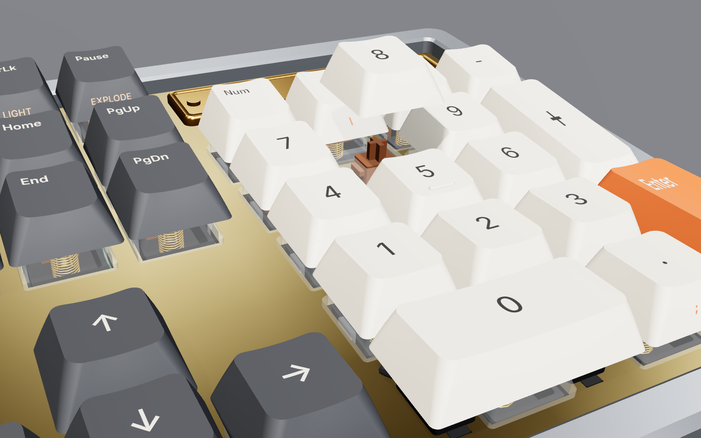
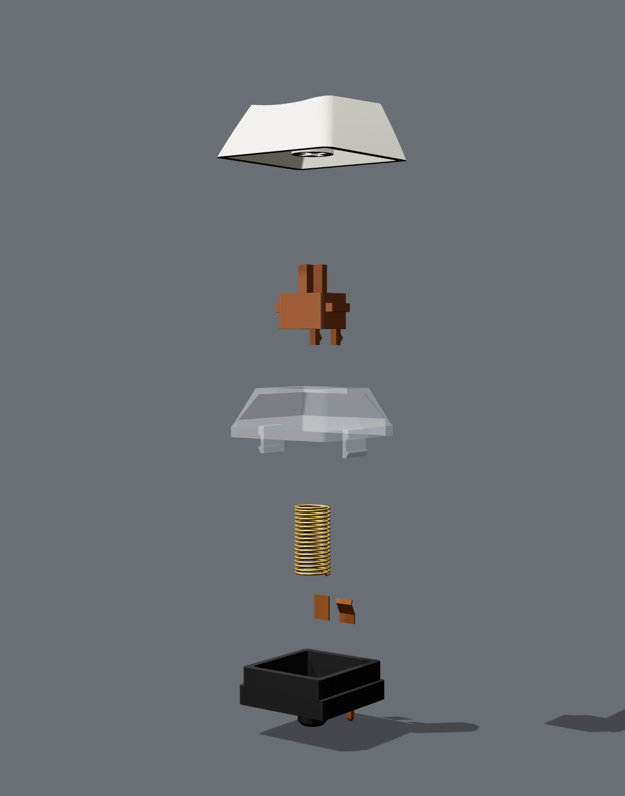

# Mechanical Calculator

[](https://github.com/jcorky/mechanical-calculator/actions/workflows/native-tests.yml)

An Unreal Engine 5 visualization of a gear-driven calculating machine that does the math of
[Where It Isn't](https://github.com/jcorky/where-it-isnt). You type on a full-size mechanical
keyboard. Behind it, a stepped-drum mechanism in the line of Leibniz's Stepped Reckoner and the
Thomas arithmometer does every calculation, and its crank, drums, carriage and carry levers move
as it works. A type-wheel printer prints the result on a paper tape.


The gears are not decoration. Every number is an 18-digit decimal held the way an operator writes
it down. Every `+ − × ÷ √` is the operator's procedure on a modelled machine with 20 setting drums,
a 40-wheel accumulator and a 21-wheel counter, with real carries and a real register width. All
468 library functions run on that machine. The motion you see is a playback of what the machine
actually did for your expression.

Everything is built in code at runtime, with no assets: every key, switch and spring, and every
gear, drum, wheel, lever, frame and shaft.

## Contents

- [Features](#features)
- [Gallery](#gallery)
- [Getting started](#getting-started)
- [Using the calculator](#using-the-calculator)
- [How the gears compute](#how-the-gears-compute)
- [Project layout](#project-layout)
- [Building and testing without Unreal](#building-and-testing-without-unreal)
- [Verification](#verification)
- [Status and known limitations](#status-and-known-limitations)
- [Licence](#licence)

## Features

### The keyboard

- **The board.** A 104-key ANSI layout with case, plate, PCB, MX switches (springs and contact leaves
  included) and stabilizers.
- **Keycaps.** Cherry-sculpted, or vintage: black round caps with chrome rims and red operator keys.
- **Switch feel.** Linear, tactile or clicky. Each key is stepped by its own switch model, timed
  against the spec, with synthesized bottom-out, top-out and click sounds.
- **Backlight and views.** An RGB backlight with six modes, and an exploded view of the build.

### The mechanism

| Part | What it does |
|---|---|
| Setting register | 20 brass stepped drums. Each drum's pinion slides along its square shaft to the digit set on it. The setting wheels and the decimal marker follow the number you type. |
| Carriage | The 40-wheel accumulator and the 21-wheel counter: black numeral wheels with white digits behind slotted window bars, and a white tens-carry lever under every wheel. The shift knob slides the carriage along its rack. |
| Drive | The crank with its turned wooden handle, the spoked drive gear and the flywheel. The reversing lever throws for subtraction and division, and the bell rings on each overdraft. |
| Printer | 18 type wheels set to the last result. The paper feeds one line per printed line. Your input sits at the print line, results print above it, and errors print in red. |
| Memory columns | Six Scheutz-style columns of brass figure wheels, each with 18 mantissa digits, a sign wheel and a 3-digit power of ten. They show `ans` and then your variables, named on their label plates. |
| Plinth | The keyboard and the machine stand on a black plinth with a brass maker's plate. A brass name plate on the keyboard shows DEG/RAD, the digit count, CAPS/SHIFT/FN and the library state. |

The frames are cast iron, the drums brass and the shafts steel. A glass cover over the drum bank
is optional.

### The calculator

- **A small matrix language.** Records with fields, 1-based indexing, and history and completion.
- **468 functions on 29 library pages**, ported from Where It Isn't's chapters and benches:
  - Möbius maps and Riccati equations; LQR, Kalman and MPC;
  - the equation sheet and the flight model;
  - radar and lens antennas;
  - orbits and inertial navigation;
  - logistics, graphs and SLAM;
  - groups, Hilbert spaces, measure and optimization;
  - lattices and GNSS, category theory, procedural systems and expansion fields.
- **2416 reference cases** check them against Where It Isn't's own JavaScript modules, or against
  independent numpy computations where a chapter has no module.

## Gallery

| | |
|---|---|
|  |  |
|  |  |
|  |  |

These images come from the preview renderer (`Tests/preview/`). It draws the same meshes outside
Unreal, so they show the geometry, not an in-engine render.

## Getting started

### Requirements

- Unreal Engine 5.4 or later.
- A C++ toolchain: Visual Studio 2022, Xcode or clang.

The project uses the engine's ProceduralMeshComponent plugin and the MeshDescription modules.
Both ship with the engine.

### Run it in Unreal

1. Right-click `MechanicalCalculator.uproject` and choose *Generate Visual Studio project files*
   (or run `GenerateProjectFiles` for your platform). Then build the `MechanicalCalculatorEditor`
   target. You can also open the `.uproject` and let the editor compile it.
2. Open the project and press **Play**. The project ships no maps or assets. The game mode adds
   the device, a desk, lights and a camera to any level that lacks them, starting from the
   engine's empty `Entry` map.
3. The keyboard types a short demo on its own, one line from each corner of Where It Isn't. Your
   first keystroke takes over.

**Packaged builds** need the master materials as assets. Run `mc.SaveMaterials` once in the editor
console, which saves them to `/Game/MechanicalCalculator/Materials`. In the editor they are built in
memory.

### Settings on the actor

These are properties of `AMechanicalKeyboard`, in the Details panel:

| Setting | Effect |
|---|---|
| Keycaps | Sculpted, or Vintage |
| Switch Type | linear (red), tactile (brown) or clicky (blue) |
| Show Mechanism | off leaves the bare keyboard, which then shows results on an OLED |
| Show Glass Cover | glass over the drum bank |
| Oled Module | fits the OLED as well as the tape |
| Motor Turns Per Second, Max Playback Seconds | how fast the mechanism plays back; long computations are compressed to fit |
| Recorded Events | how much of each computation the machine records for playback |
| Maker's Plate Text | the engraving on the plinth |
| Theme | every colour |
| Flip Winding | reverses every triangle, if your engine version renders the meshes inside out |

### Controls

| Control | |
|---|---|
| Type | the virtual keyboard follows your keyboard |
| Left click | presses a key (modifiers stay down until the next key) |
| Right drag | orbits the camera; the middle button pans, the wheel zooms, a thumb button resets |
| Enter | evaluates the line. The keyboard locks while the motor runs, and any key hurries it to the result. |
| Tab | completes a function name |
| F1 | help for the function at the cursor |
| F2 / F3 | DEG–RAD, display digits |
| F4 or Menu | the library browser: arrows to move, Enter to insert |
| F5–F12 | `sqrt(`, `^2`, `ln(`, `exp(`, `sin(`, `cos(`, `tan(`, `pi` |
| Up / Down | history; PgUp / PgDn scroll the tape |
| Pause | exploded view of the keyboard |
| ScrLk | backlight: off, static, wave, breathe, reactive, roles |
| Shift + numpad | `\` `.*` `'` `,` `;` for matrix entry |
| Num Lock off | the numpad navigates |

In the editor, Esc ends Play-in-Editor before the keyboard sees it (on the board it clears the
line). Shift+F1 frees the mouse.

## Using the calculator

```
> h = hohmann(6678e3, 42164e3)        records print every field
= dv1 = 2425.769028
  dv2 = 1466.838715
  ...
> h.dv1 + h.dv2                       fields and 1-based indexing: h(1)
= 3892.607744
> db(snr_track(1.4e6, 2000, 0.1, 1, 111e3, 950, 1.67e6, 6.3))
= 1.294026112                         the Lincoln lecture's airport radar, as printed
> A = [1, 0.1; 0, 1]; B = [0.005; 0.1]
> P = dare(A, B, eye(2), 0.5)         matrices: ',' columns, ';' rows
> rho(A - B * dlqr(A, B, eye(2), 0.5))
```

- **Operators:** `+ - * / ^`, element-wise `.* ./ .^`, transpose `'`, left division `A \ b`
  (least squares when A is not square), and factorial `!`.
- **Syntax:** `x = ...` assigns, `;` separates statements, and `ans` holds the last value.
- **Constants:** `pi`, `e`, `g0`, `c0`, `kB`, `T0`, `mu_earth`, `R_earth`, `gamma_air`, `cp_air`,
  `R_air`, `ft`, `nmi`, `kt`, `km`, `hr`, `day`, `inf`, `nan`.
- **Commands:** `help <fn>`, `list`, `list <page>`, `vars`, `clear`, `deg`, `rad`, `digits <n>`.

Units are SI. Angles are radians, except in the elementary trig functions, which follow the
DEG/RAD key.

Results carry up to 18 significant digits, and `digits <n>` sets how many are printed. Decimal
input is exact, so `0.1 + 0.2 == 0.3`. Each result on the tape is followed by the work it took, for
example `~ 1290 turns, 431 shifts`.

Every function is listed in **[Docs/FUNCTIONS.md](Docs/FUNCTIONS.md)**, generated from the
registry, with its arguments, its units and where it lives in Where It Isn't.

## How the gears compute

The calculator has one arithmetic unit, `SteppedDrumMachine` (`Calc/GearMachine.h`), and every
operation on a number is one of the operator's five procedures on it:

| Operation | Procedure |
|---|---|
| `a + b`, `a − b` | set the operands at carriage positions that line up their decimal points, and turn once each (reversed for a difference) |
| `a × b` | for each multiplier digit, shift and turn that many times; the counter shows the multiplier and the accumulator the exact product |
| `a ÷ b` | at each place, turn reversed until the bell rings, restore with one forward turn, and shift down |
| `√a` | Toepler's method: subtract the odd numbers 20y + 1, 20y + 3, … at each column pair until the bell |
| a series | turn the terms into the accumulator without clearing it, and read the sum once |

`Real` (`Calc/GearReal.h`) holds a sign, 18 significant digits and a power of ten. Its operators
*are* these procedures.

A fast path computes the same register contents with integer arithmetic. The tests prove it equal
to the wheel-by-wheel machine, digit for digit, on 15,000 random operations.

The elementary functions are built from the five procedures alone (`Calc/GearMath.h`). So are the
linear algebra and all 468 library functions. π, ln 2 and ln 10 are computed on the gears and
correctly rounded.

**[Docs/GEARS.md](Docs/GEARS.md)** has the full account.

When you press Enter, the evaluation runs on a worker thread with a recorder attached. The
recorder captures every set, shift, turn, carry and bell. `MechanismPlayer` turns the record into
continuous motion, and `MechanismAnimator` turns that into a pose for every moving part. The
result prints when the mechanism stops.

## Project layout

```
MechanicalCalculator.uproject     UE 5.4, ProceduralMeshComponent plugin
Config/                           entry map, game mode, input
Source/MechanicalCalculator/
  Calc/       the calculator: expression language and session; linear algebra (LU, QR/SVD,
              Jacobi, Francis QR, Pade expm, DARE by doubling, CARE by the matrix sign function,
              Lyapunov); one library file per part of Where It Isn't (Lib*.cpp); and the gear
              arithmetic: Real, the stepped-drum machine, the operator's procedures and the
              elementary functions built from them
  Geometry/   procedural meshes: keycaps (sculpted or vintage), switches, stabilizers, plate,
              PCB and case; and the mechanism: involute spur and bevel gears, stepped drums,
              numeral wheels, the carriage, frames, crank and flywheel, printer, memory columns
              and plinth
  Keyboard/   the firmware (input line, history, completion, tape, library browser), switch
              dynamics, synthesized key and gear sounds, RGB backlight, the 104-key ANSI layout,
              the mechanism player and animator, and the memory-column readings
  Public/, Private/
              the Unreal layer: AMechanicalKeyboard, the viewer pawn, the studio set, the game
              mode, runtime materials, procedural audio, and runtime static meshes for the
              mechanism's instanced parts
Tests/        native CMake build with the tests, the reference cases and their generators,
              the CLI and the preview renderer
Docs/         GEARS.md, FUNCTIONS.md and the preview images
```

Everything under `Calc/`, `Geometry/` and `Keyboard/` is plain C++17 with no engine dependency. It
is written to Unreal's rules: no exceptions, no RTTI, and names that are safe in a unity build.

The Unreal layer is thin:

- **Meshes.** It converts the keyboard's meshes to `UProceduralMeshComponent` sections, and each
  mechanism part to one runtime `UStaticMesh` drawn by an instanced static mesh component. The 126
  memory wheels alone would be two million procedural-mesh vertices; as instances they share one
  mesh.
- **Each tick.** It steps the switch models, forwards keystrokes to the firmware, and copies the
  animator's poses to the instances.

## Building and testing without Unreal

The calculator, geometry and keyboard models build natively with CMake. The tests run there, and
so does a command-line calculator using the same engine:

```sh
cmake -S Tests -B build && cmake --build build -j
./build/mcalc_tests                       # every test and reference case
./build/mcalc_cli                         # a REPL with the same engine
./build/mcalc_cli --markdown > Docs/FUNCTIONS.md   # regenerate the function reference
```

The build uses `-Wall -Wextra -Wshadow -Werror -fno-exceptions -fno-rtti`. It force-includes a
header that defines the macros Unreal and Windows define (`PI`, `check`, `IN`, `near`, `ERROR`, …).
It also compiles every file as one translation unit, as Unreal Build Tool does, so name collisions
fail here first.

| Option | |
|---|---|
| `MCALC_CASES=orbits.tsv ./build/mcalc_tests` | run only the named reference files (`none` skips them) |
| `cmake -DMCALC_ONLY_LIB=Orbits …` | build just one library file (the others register nothing), for working on one library at a time |

**Reference cases.** Each case is an expression, typed exactly as on the keyboard, with its
expected value. They live in `Tests/reference/*.tsv`, written by the `gen_*` scripts from Where It
Isn't's own modules or from numpy ports of its verification scripts. To rebuild them (Node 22,
Python 3 with numpy):

```sh
Tests/reference/regenerate.sh /path/to/where-it-isnt
```

**Preview images.** These are rendered with three.js in headless Chromium:

```sh
./build/mcalc_export_obj /tmp/preview
node Tests/preview/render.mjs /tmp/preview Docs/images hero mechanism gears_closeup
```

**Continuous integration** (`.github/workflows/native-tests.yml`) builds and tests with g++ and
clang++. It also regenerates the reference cases from a fresh checkout of Where It Isn't and runs
`Tests/reference/compare.py`. That script fails if any expression, tolerance or provenance
changed, or if an expected value moved by more than a hundredth of its tolerance.

## Verification

| What | How |
|---|---|
| The library | 2416 reference cases from Where It Isn't's own modules (`orbits.js`, `radar.js`, `equations.js`, `logistics.js`, …) or numpy ports of its verification scripts, regenerated in CI |
| Properties | per-library tests, for example: Lambert's solution flown by the integrator lands on r2, the CW matrix equals `expm` of Hill's equations, LLL meets its bound, Sinkhorn's marginals hold, and no strategy beats the game's par |
| The gears | the fast path against the literal wheel-by-wheel machine on 15,000 random operations; carries through runs of 9s and 0s; the bell on overdraft; Toepler's square root; correctly rounded constants; the elementary functions against `<cmath>` (worst relative error 1.9 × 10⁻¹⁵) |
| Linear algebra | eigenvalues of similarity-transformed triangular matrices, SVD reconstruction, `expm` closed forms, DARE against 5000 Riccati iterations, the CARE residual and its closed form, and Lyapunov residuals |
| Geometry | every part closed and outward-facing, with positive volume by the divergence theorem and the right Euler characteristic; every switch inside its plate cut-out; every gear pair meshing at its centre distance; every numeral wheel's digits facing its reading window |
| Mechanism | the player ends exactly on the machine's registers. After 271828 × 315 the accumulator windows read 85625820 and the counter 315. The pinions sit at their digits, the reverser turns the drums backward, the memory columns and type wheels settle on `ans`, and the paper feeds by the line. |
| Keyboard | typing through the physical layout (shift, caps, numpad matrix entry), editing, history, completion, the screen layout, switch timing against the spec, and the sounds |

A few reference tolerances were loosened for the move to 18-digit decimal arithmetic. Each one is
noted in its generator, with a 50-digit check of which value is closer.

## Status and known limitations

- **The Unreal layer has not been compiled against the engine or run.** `Public/` and `Private/`
  have been checked against stub headers for syntax and types only, because this repository was
  built where Unreal is unavailable. Expect a first build to need small API fixes for your engine
  version. The most likely place is the runtime static-mesh build (`KeyboardMesh::BuildStaticMesh`,
  which uses `UStaticMesh::BuildFromMeshDescriptions`). If the meshes render inside out, set
  **Flip Winding** on the actor.
- **The first `allanfit` or `allansim` with a new seed takes about 4.5 seconds**, because the
  simulation runs on the gears.
- **Results can differ from the JavaScript reference values in the last digits** wherever a
  computation is ill-conditioned, because they carry 18 decimal digits rather than about 16 binary
  ones.

## Licence

MIT. See [LICENSE](LICENSE).
